# Guía de sustentación: emisiones de turbinas de gas

## 1. Contextualización del problema

- **Negocio de origen: generación de electricidad.** Una planta usa combustible para producir energía eléctrica. En una turbina de gas, el aire se comprime, se mezcla con combustible y se quema; los gases calientes mueven la turbina, que acciona el generador. Fuente: [Departamento de Energía](https://www.energy.gov/hgeo/how-gas-turbine-power-plants-work).
- **Problema industrial:** además de energía, la combustión produce contaminantes, entre ellos CO y NOx. El operador necesita seguir las emisiones junto con la producción y las condiciones del equipo. Fuente: [EPA](https://www.epa.gov/natural-gas-star-program/engine-exhaust).
- **Qué busca el proyecto:** estimar las concentraciones de CO y NOx a partir de sensores que ya describen la operación. Es un apoyo al monitoreo, no un sistema de control automático.
- **Valor potencial para el negocio:** complementar el seguimiento de emisiones y reconocer condiciones que ameriten revisión. El proyecto no calcula ahorros ni demuestra que el modelo reduzca emisiones.
- **Quién usaría el resultado:** personal de operación, ingeniería y gestión ambiental, como herramienta de análisis.
- **Datos de origen:** 36.733 registros de una turbina de una planta eléctrica en Turquía, entre 2011 y 2015. Cada fila resume una hora. Los archivos conservan el orden, pero no fechas exactas. Fuente y diccionario: [UCI](https://archive.ics.uci.edu/dataset/551/gas+turbine+co+and+nox+emission+data+set).
- **Pregunta central:** «¿Qué tan bien podemos estimar las emisiones del registro actual con nueve sensores ambientales y operativos?».
- **Alcance:** se estudia una turbina y condiciones representadas en esos cinco años. No se está pronosticando el día siguiente ni demostrando desempeño en otra planta.

## 2. Datos y variables

- **Unidad de observación:** una fila que resume la operación durante una hora; no representa una turbina diferente.
- **Variables objetivo:** CO, monóxido de carbono, y NOx, óxidos de nitrógeno. Son las cantidades que se busca estimar. CO no es CO₂.
- **Unidad de las emisiones:** mg/m³, miligramos de contaminante por metro cúbico de gas. Es concentración; para calcular masa emitida por hora también se necesitaría el caudal.
- **Ambiente:** AT, temperatura; AP, presión; AH, humedad relativa.
- **Operación:** AFDP, diferencia de presión del filtro; GTEP, presión de escape; TIT, temperatura de entrada; TAT, temperatura de salida; CDP, presión de descarga del compresor; TEY, energía producida durante el intervalo.
- **Unidades de sensores:** °C para temperaturas, mbar para presión, % para humedad y MWh para energía. Un MWh es una cantidad de energía, no una temperatura ni una concentración.
- **Entradas excluidas:** CO y NOx no se usan para estimarse entre sí. Año, posición y bloque organizan la evaluación, pero no entran al modelo.

## 3. EDA: qué mostrar y qué decir

- **Calidad:** mostrar la tabla de faltantes y los controles de coherencia. No hay valores faltantes en la muestra de desarrollo; se revisan duplicados y humedad ligeramente superior al 100% sin corregirla arbitrariamente.

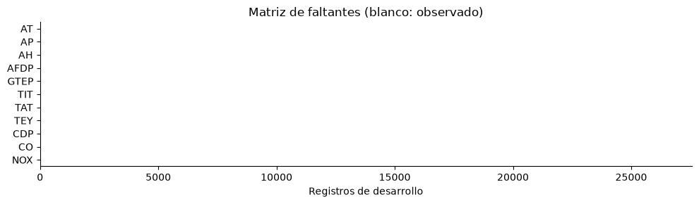

- **Distribuciones:** usar el histograma y las cajas. CO presenta una cola hacia concentraciones elevadas: hay episodios altos menos frecuentes que pueden producir errores grandes.
- **Extremos:** explicar que un valor alejado de lo habitual no es necesariamente erróneo. Se mantienen para evaluar también situaciones difíciles de interés operativo.

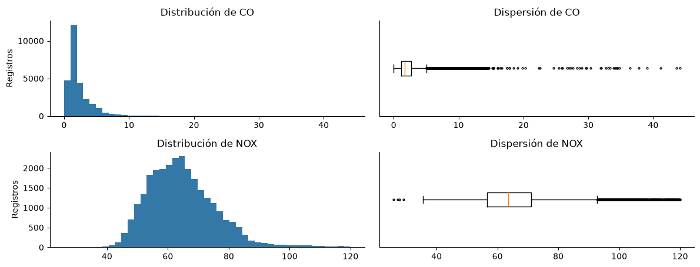

- **Relaciones:** mostrar una dispersión y el mapa de correlaciones. Algunas variables se mueven juntas y pueden compartir información; esto no significa que una cause el cambio de la otra.

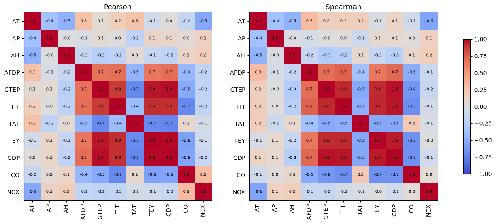

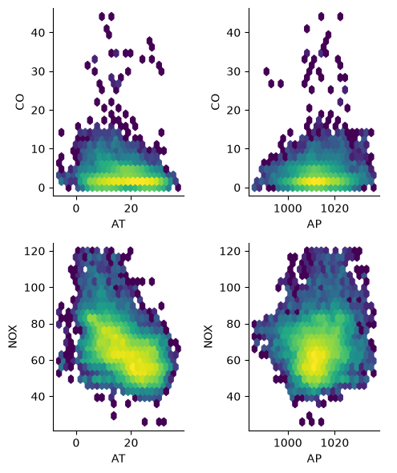

- **Estructura conjunta:** PCA resume los sensores y KMeans agrupa situaciones parecidas. Son herramientas para describir condiciones, no etiquetas confirmadas de estados físicos de la turbina.

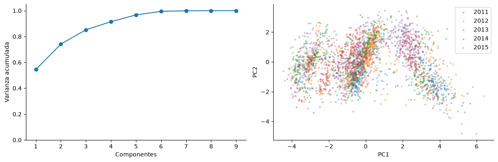

- **Dependencia temporal:** emisiones de registros vecinos se parecen. La ACF de primer rezago está entre 0,525 y 0,773 para CO y entre 0,864 y 0,894 para NOx. Esta persistencia motiva la evaluación por bloques.

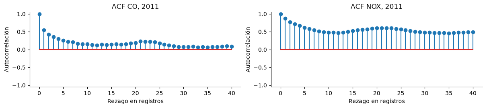

- **Cambio anual más importante:** NOx baja de 70,01 mg/m³ en 2013 a 60,07 en 2014 y 59,89 en 2015. La caída 2013–2014 es de 9,94 mg/m³.
- **No confundir promedios con distribuciones:** NOx tiene promedios parecidos en 2014 y 2015, pero cambia su mediana y su dispersión.
- **CO no aumenta de forma uniforme:** su promedio es 1,57 en 2011, 2,36 en 2012, 2,72 en 2013, 2,08 en 2014 y 3,13 mg/m³ en 2015.

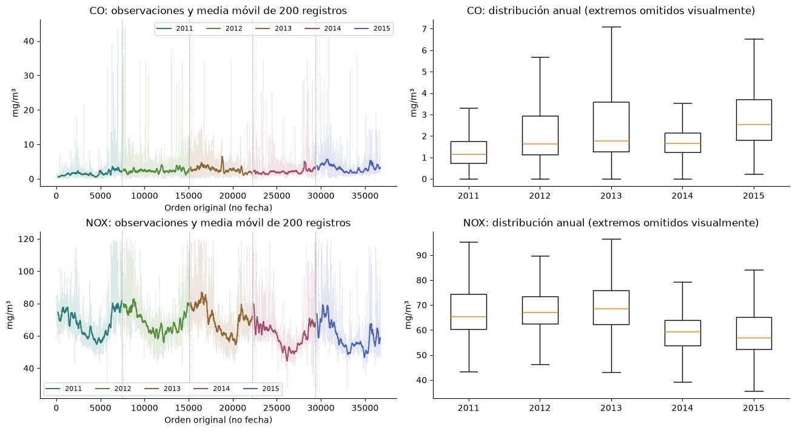

- **Estacionalidad:** no se detecta un ciclo regular significativo de 24 o 168 registros con el método aplicado. Esto no contradice la persistencia local ni las diferencias anuales.
- **Lectura de la gráfica cíclica:** el eje horizontal indica la posición que vuelve a empezar cada 24 o 168 registros. El vertical muestra el cambio estimado alrededor de cero, no la concentración promedio. No son horas del día verificadas.

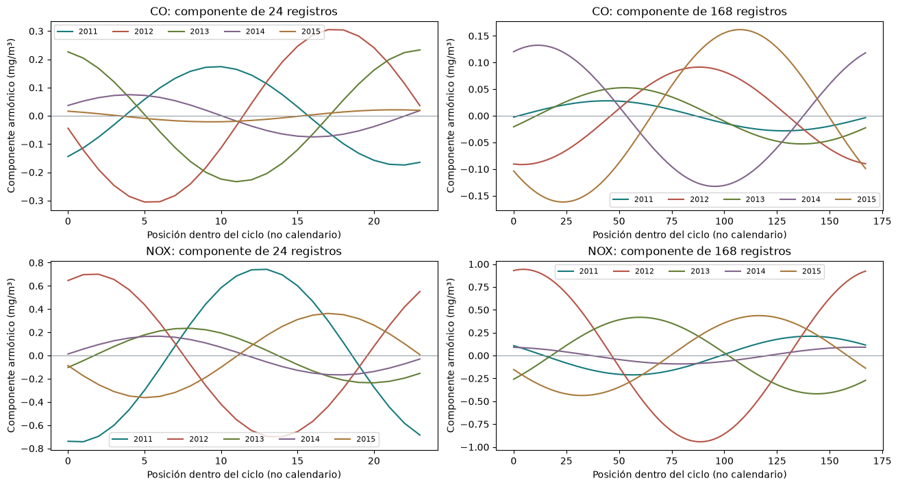

- **Mensaje de cierre del EDA:** los datos tienen extremos, relaciones no lineales, dependencia entre vecinos y cambios anuales; la validación debe respetar esa estructura.

## 4. Entrenamiento y validación

- **Regresión supervisada:** el modelo aprende con ejemplos que contienen sensores y emisiones medidas, para estimar una cantidad numérica.
- **Separación de datos:** desarrollo, 27.570 registros; prueba, 7.411; margen excluido, 1.752. La reserva de prueba es aproximadamente el 20% de los registros originales.

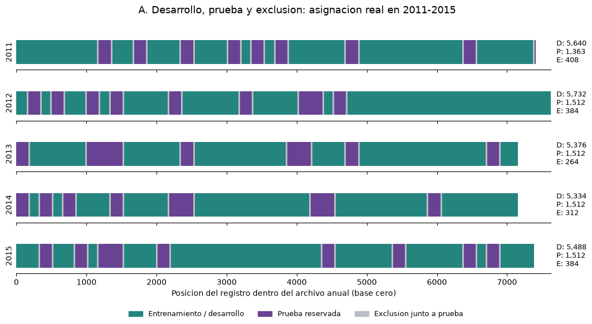

- **Bloques de 168:** se apartan grupos de observaciones próximas, no filas aisladas. Esto reduce una evaluación excesivamente fácil entre vecinos muy parecidos.
- **Margen de 24:** se excluyen hasta 24 posiciones a cada lado de la prueba o validación. Es una separación de seguridad entre ajuste y evaluación, no una afirmación de que la dependencia termine exactamente ahí.

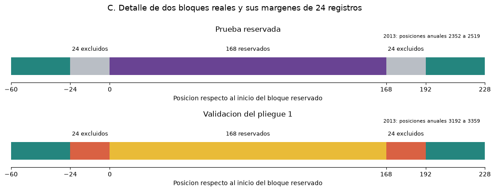

- **Validación cruzada:** se repite el entrenamiento dejando un grupo fuera cada vez.
- **Validación anidada 5 × 3:** los tres grupos internos eligen configuraciones; los cinco grupos externos evalúan ese procedimiento. Así, ajustar controles y medir desempeño no se hacen con los mismos registros de evaluación.

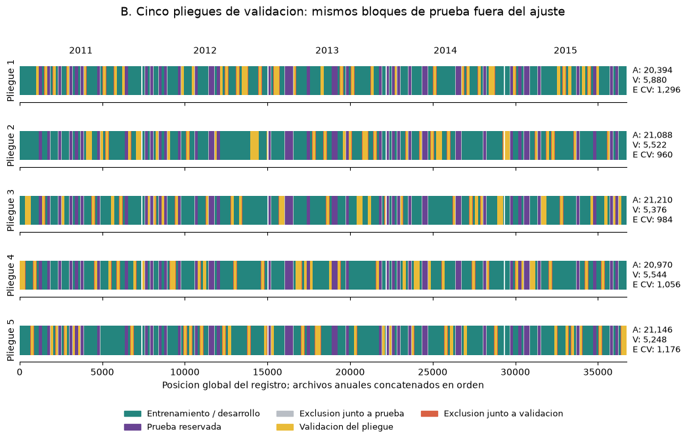

- **Por qué no LOYO como protocolo principal:** dejar un año completo fuera evalúa un periodo desconocido. Aquí interesa estimar condiciones representadas en los cinco años. LOYO sería pertinente para una pregunta de transferencia a otro periodo.
- **Prevención de fuga:** no se incluyen las emisiones como entradas; el escalado se aprende solo en cada entrenamiento y se respetan bloques y márgenes.
- **Modelos de referencia:** Ridge, Lasso, KNN, árbol de decisión, Random Forest, XGBoost y SVR lineal. Todos se evalúan por separado para CO y NOx.
- **Búsqueda:** cuatro métodos de configuración por familia y emisión, 56 procedimientos. El kernel operativo añade 24 configuraciones por emisión.
- **Regla de elección:** menor MSE medio de validación, no mayor puntuación observada en prueba.

## 5. Propuesta: kernel operativo

- **Arquitectura en una frase:** «Dos modelos ven los mismos sensores de maneras diferentes; un tercero aprende a combinar sus estimaciones».

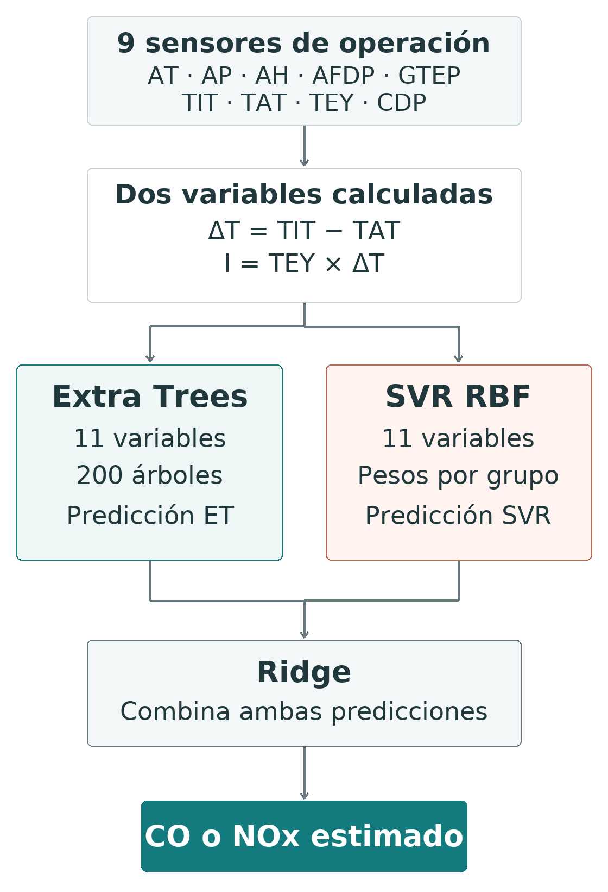

- **Extra Trees:** 200 árboles que aplican reglas sobre los sensores y promedian sus resultados.
- **Qué es un árbol de regresión:** una secuencia de reglas como «TIT por debajo de un límite». El recorrido termina en una hoja, que estima la emisión a partir de los registros de entrenamiento que llegaron allí.
- **Qué cambia en un Extra Tree:** propone límites aleatorios para dividir los datos y elige el mejor entre esos candidatos. Extra Trees combina muchos de esos árboles; la predicción final es su promedio. Fuente: [ExtraTreesRegressor](https://scikit-learn.org/stable/modules/generated/sklearn.ensemble.ExtraTreesRegressor.html).
- **Frente a un árbol de decisión:** no depende de un único conjunto de reglas. Al promediar árboles diferentes, sus errores pueden compensarse.
- **Frente a Random Forest:** ambos promedian árboles independientes. Random Forest busca mejores límites en cada división y, en nuestro ajuste, remuestrea registros con reemplazo: algunos se repiten y otros no entran en un árbol. Extra Trees añade aleatoriedad a los límites y usa todo el entrenamiento disponible para cada árbol, sin ese remuestreo. Fuente: [RandomForestRegressor](https://scikit-learn.org/stable/modules/generated/sklearn.ensemble.RandomForestRegressor.html).
- **Frente a XGBoost:** Extra Trees construye árboles independientes y promedia; XGBoost los añade en secuencia para corregir errores del conjunto anterior. Fuente: [métodos de ensamble](https://scikit-learn.org/stable/modules/ensemble.html).
- **Por qué se combina con SVR:** los árboles representan reglas sobre condiciones de operación y SVR representa semejanzas entre registros. Pueden aportar información complementaria; la diversidad no garantiza mejor rendimiento ni elimina el sobreajuste.
- **SVR con kernel RBF:** estima usando la semejanza con situaciones de referencia; los grupos de sensores tienen distintos pesos para definir esa semejanza.
- **Ridge como combinador:** aprende cuánto usar de cada predicción, evitando pesos excesivos.
- **Dos variables adicionales:** diferencia de temperatura de entrada y salida, y esa diferencia multiplicada por TEY. Se calculan con las entradas existentes.
- **Interpretación:** la primera resume caída térmica; la segunda representa conjuntamente caída térmica y producción. No son medidas directas de eficiencia ni causas demostradas de las emisiones.
- **Stacking sin fuga:** Ridge aprende con predicciones de registros apartados de su propio ajuste. No aprende de predicciones artificialmente perfectas de entrenamiento.
- **Configuraciones separadas:** CO y NOx comparten arquitectura, pero tienen pesos y penalizaciones propios.
- **Aporte frente a literatura:** la propuesta integra variables operativas explícitas, semejanzas ponderadas y Extra Trees–SVR–Ridge. Los componentes son conocidos; la combinación exacta no se identificó en la revisión para esta tarea.
- **No presentar una atribución no evaluada:** todavía no se ha separado cuánto aporta cada variable, cada peso y cada modelo. Para ello se requiere una ablación.

## 6. Resultados principales

| Emisión | Modelo | R² entrenamiento | R² validación externa | R² prueba | RMSE prueba | MAE prueba |
|---|---|---:|---:|---:|---:|---:|
| CO | Kernel operativo | 0,8762 | 0,7097 | 0,7491 | 1,2838 | 0,5869 |
| NOx | Kernel operativo | 0,9404 | 0,7815 | 0,8242 | 5,3426 | 3,2821 |

- RMSE y MAE están en mg/m³. El R² de validación es el promedio de los cinco grupos externos.
- **Elección:** kernel operativo para ambas emisiones, por su menor MSE de validación entre las ocho familias publicadas.
- **CO:** frente a Random Forest, R² de prueba sube de 0,7260 a 0,7491. La mejora es significativa en validación, pero no en prueba: p ajustado 0,0345 y 0,5092, respectivamente.
- **NOx:** frente a XGBoost, R² de prueba sube de 0,7969 a 0,8242. La mejora es significativa tanto en validación como en prueba: p ajustado 0,0018 y 0,0004.

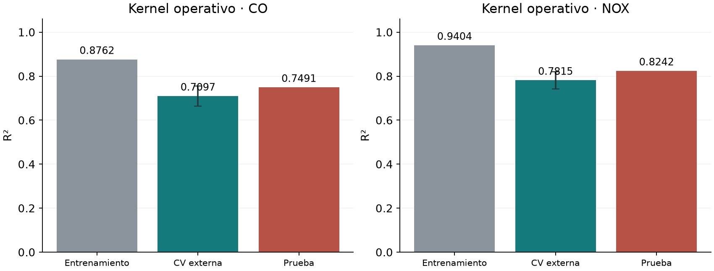

- **Importancia de sensores en el kernel:** TIT, TAT y TEY encabezan CO; TIT, AT y TEY encabezan NOx. Es dependencia predictiva del modelo, no una jerarquía de causas físicas.

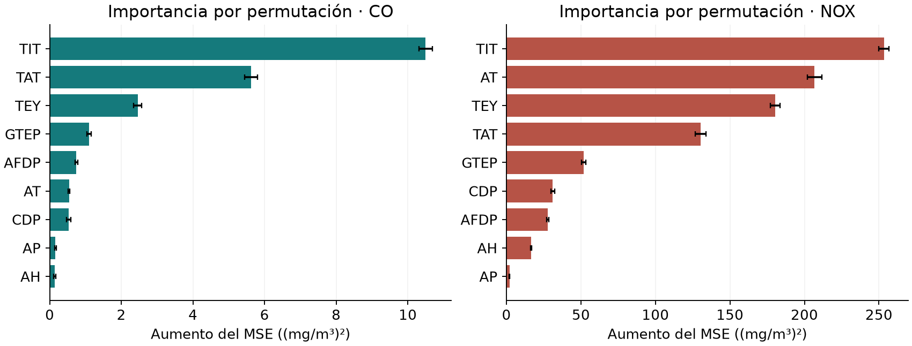

- **Sobreajuste:** entrenamiento supera validación y prueba. La brecha sigue presente; no se afirma haber eliminado el problema.
- **Literatura:** mostrar Sinap, Kochueva y Jhinaoui para explicar diferencias de filtrado, periodos o historial. No comparar sus cifras como si todos hubieran respondido al mismo examen.
- **Cierre sugerido:** «La propuesta mejora el desempeño numérico para ambas emisiones; la evidencia de mejora es consistente para NOx. Para CO, la prueba todavía no confirma una ventaja significativa sobre Random Forest».

### 6.1. Curvas de aprendizaje

- **Qué muestran:** cómo cambia el desempeño cuando el modelo dispone de más registros para aprender. Se calculan para los ocho modelos, por separado para CO y NOx.
- **Eje horizontal:** cantidad media de registros usados para entrenar en cada pliegue. Se incorporan aproximadamente 20%, 40%, 60%, 80% y 100% de los bloques disponibles de cada año.
- **Eje vertical:** R²; un valor mayor indica mejor desempeño. En el dashboard también puede seleccionarse RMSE, donde un valor menor es mejor.
- **Dos líneas:** gris para entrenamiento y verde para validación. Cada punto es el promedio de cinco pliegues; las franjas muestran una desviación estándar entre ellos, no un intervalo de confianza.
- **Cómo leer la brecha:** una línea de entrenamiento alta y otra de validación más baja sugiere sobreajuste. Si la validación mejora y la brecha se reduce al añadir datos, la generalización mejora. Si ambas se estabilizan con resultados modestos, más datos por sí solos podrían no resolver la limitación del modelo.
- **Cómo se calculan:** se conservan los grupos de validación y el margen de 24 registros. La configuración elegida dentro de cada pliegue se mantiene fija; el escalado vuelve a aprenderse con cada subconjunto. En el kernel, Ridge recibe predicciones internas fuera de muestra.
- **Qué significa el 100%:** utiliza todo el entrenamiento disponible dentro de cada pliegue, no los 27.570 registros del ajuste final. Por eso su R² de entrenamiento no tiene que coincidir con la tabla principal. El conjunto de prueba no se utiliza en estas curvas.

- **KNN:** el R² de entrenamiento permanece en 1 y la validación mejora al añadir datos, pero persiste una brecha amplia. Ajustar perfectamente los registros conocidos no garantiza estimar bien otros registros.

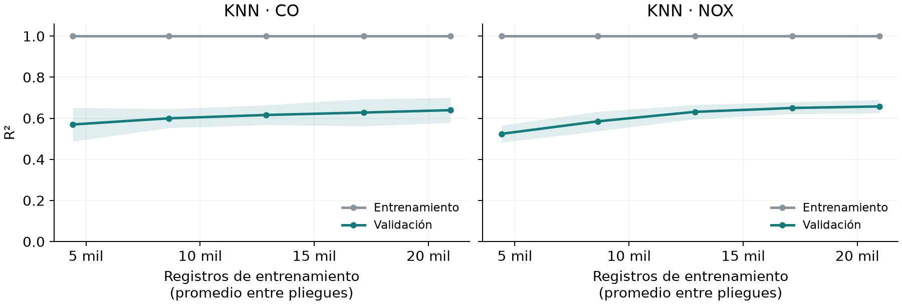

- **Ridge:** las líneas se acercan, pero el R² final de validación es aproximadamente 0,539 para CO y 0,493 para NOx. Una brecha pequeña no equivale por sí sola a un buen desempeño.

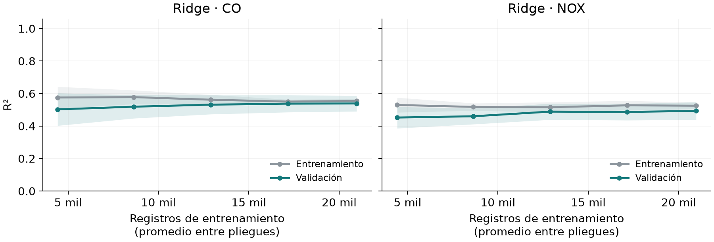

- **Lasso:** presenta un patrón parecido a Ridge: menor separación con más datos, pero resultados de validación modestos. La cercanía de las curvas no basta para preferirlo a los modelos no lineales.

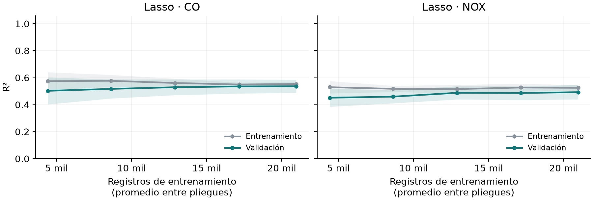

- **Árbol de decisión:** la validación mejora al incorporar bloques, especialmente para NOx, pero mantiene una diferencia frente al entrenamiento. Más datos ayudan sin resolver por completo la dificultad para generalizar.

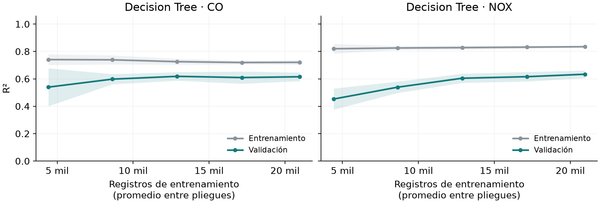

- **Random Forest:** la validación mejora y la separación se reduce con más datos. Al final, la brecha es mayor para NOx que para CO; el promedio de árboles no elimina todo el sobreajuste.

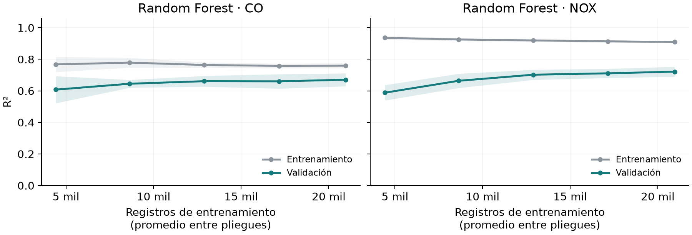

- **XGBoost:** añadir datos eleva la validación y reduce la brecha. La diferencia no desaparece, por lo que el alto ajuste inicial de entrenamiento no debe presentarse como capacidad de predicción.

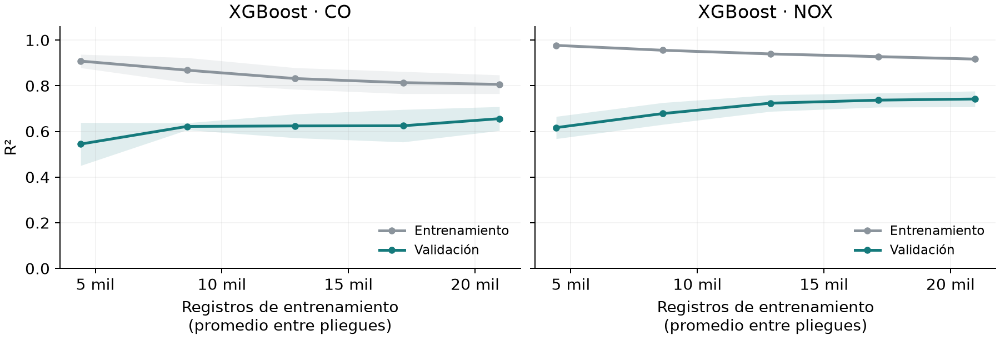

- **SVR lineal:** se aproxima al patrón de Ridge y Lasso. Sus curvas cercanas, con desempeño moderado, son compatibles con una limitación de la relación lineal y no solo con falta de registros.

- **Kernel operativo:** entre el 20% y el 100%, el R² medio de validación sube de 0,6414 a 0,7097 para CO y de 0,6724 a 0,7815 para NOx. La brecha se reduce en ambas emisiones, pero persiste. La tendencia observada no garantiza que continúe con datos adicionales.

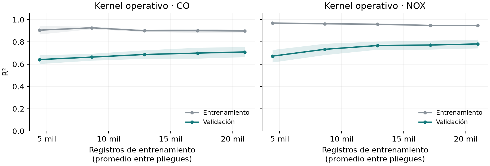

- **Lectura conjunta:** no se busca únicamente que las líneas coincidan. Los modelos lineales tienen menor separación, pero el kernel alcanza mejor validación. La elección combina capacidad predictiva y control del sobreajuste.

## 7. Guion breve de exposición

- **Apertura:** explicar cómo la planta genera electricidad y por qué necesita seguir sus emisiones.
- **Problema de datos:** presentar los nueve sensores, las dos emisiones y la concentración en mg/m³.
- **EDA:** seleccionar distribución (figura 2), cambio anual de NOx (figura 7) y dependencia entre vecinos (figura 6); cerrar con la ausencia de un ciclo fijo detectado (figura 8).
- **Validación:** mostrar los bloques y el margen (figuras 9 a 11), y explicar los dos niveles de validación con una sola frase cada uno.
- **Comparadores:** describir las familias y la regla de selección, sin leer cada hiperparámetro.
- **Propuesta:** mostrar el diagrama del kernel (figura 12) y explicar las dos variables operativas y la combinación de modelos.
- **Resultados:** presentar R², RMSE, MAE y la diferencia entre CO y NOx en significancia; apoyar la lectura con las figuras 13 y 14.
- **Aprendizaje:** mostrar la curva del kernel operativo (figura 22), explicar los dos ejes y la diferencia entre entrenamiento y validación. Usar las figuras 15 a 21 para contrastar los demás modelos.
- **Conclusión:** utilidad potencial, límites de una sola turbina y necesidad de datos nuevos para una aplicación operativa.

## 8. Conceptos de datos y EDA

- **Variable o característica:** una columna que describe una observación; por ejemplo, temperatura de entrada.
- **Predictor o entrada:** variable disponible para estimar otra. **Objetivo o respuesta:** cantidad que se quiere estimar.
- **Continuo:** puede tomar muchos valores numéricos, como 18,2 °C. **Categoría:** una clase, como tipo de equipo.
- **Promedio o media:** suma de valores dividida por su cantidad. Es sensible a valores muy altos.
- **Mediana:** valor central al ordenar los datos; la mitad queda por debajo y la mitad por encima.
- **Percentil:** punto bajo el cual cae cierto porcentaje de observaciones; el percentil 90 deja aproximadamente el 90% por debajo.
- **Cuartiles e IQR:** los percentiles 25 y 75 delimitan el 50% central. IQR = Q3 − Q1. La regla de extremos usa Q1 − 1,5·IQR y Q3 + 1,5·IQR.
- **Varianza y desviación estándar:** medidas de dispersión respecto al promedio. La desviación estándar vuelve a las unidades de la variable; la varianza usa unidades al cuadrado.
- **Escala logarítmica:** comprime números grandes para poder comparar cantidades que difieren mucho; pasos iguales en el eje representan multiplicaciones, no sumas iguales.
- **Asimetría y cola:** describen si la distribución se extiende más hacia un lado. Una cola derecha contiene valores altos poco frecuentes.
- **Normalidad o distribución gaussiana:** forma de campana aproximadamente simétrica. D’Agostino–Pearson resume desviaciones de esa forma con el estadístico K².
- **Estadístico:** número calculado para resumir la evidencia de una prueba. H en Kruskal–Wallis y K² en normalidad no son métricas de precisión.
- **Histograma:** barras con la cantidad de registros en cada intervalo. **Caja:** mediana, rango central y extensión de valores no señalados como extremos.
- **Dispersión y densidad hexagonal:** la primera muestra pares de valores; la segunda agrupa puntos en hexágonos para reconocer concentraciones de datos.
- **Correlación Pearson:** grado de relación recta. **Spearman:** grado de relación creciente o decreciente según el orden de los valores.
- **Relación monotónica:** al aumentar una variable, la otra tiende a avanzar siempre en la misma dirección, aunque no siga una recta.
- **Causalidad:** que modificar una condición produzca un cambio. Ver que dos variables se relacionan no basta para demostrarla.
- **Multicolinealidad y VIF:** varios sensores aportan información lineal parecida; VIF mide cuánto dificulta eso estimar sus pesos por separado.
- **Información mutua:** cantidad estimada de información compartida entre dos variables, incluso sin una relación recta. No se interpreta como porcentaje de precisión.
- **PCA y componentes:** nuevas columnas que combinan sensores para resumir su variación. PC1 y PC2 son las dos primeras; no necesariamente las más útiles para predecir.
- **KMeans o agrupamiento:** reúne registros con valores parecidos; un grupo o cluster no tiene por sí mismo una etiqueta física confirmada.
- **Silhouette:** compara cercanía al propio grupo con cercanía a otros. Cerca de 1 indica separación; cerca de 0, superposición; negativo, posible asignación poco clara.
- **Isolation Forest:** identifica configuraciones que se separan con pocas reglas aleatorias, por ser menos habituales. Señalar un 2% no demuestra que ese porcentaje sean errores.
- **Imputación:** reemplazar mediciones faltantes mediante una regla. No fue necesaria para los datos completos de este proyecto.

## 9. Conceptos temporales y de distribución

- **Rezago:** cantidad de posiciones entre dos registros; no es una fecha ni una duración verificada en estos archivos.
- **Media móvil:** promedio de una ventana que se desplaza; suaviza oscilaciones para reconocer cambios de nivel.
- **Dependencia serial y persistencia:** registros próximos comparten información. Por eso el tamaño de la tabla supera la cantidad de información independiente.
- **Heterogeneidad:** diferencias entre grupos o periodos; por ejemplo, distribuciones de NOx distintas entre años.
- **ACF:** relación entre una variable y ella misma a diferentes rezagos. **PACF:** relación que queda al descontar los rezagos intermedios.
- **Tendencia:** cambio sostenido a lo largo de la secuencia. **Pendiente:** cuánto sube o baja por unidad de avance.
- **Theil–Sen:** estima una pendiente combinando cambios entre pares; es menos sensible a extremos. **Kendall τ:** resume si los valores avanzan de manera ordenada en una dirección.
- **Estacionariedad:** estabilidad aproximada del promedio y del patrón de variación a lo largo de la secuencia.
- **Raíz unitaria y ADF:** una raíz unitaria describe una persistencia en la que los efectos de perturbaciones no desaparecen de forma usual; ADF parte de esa hipótesis y busca evidencia para rechazarla.
- **KPSS:** parte de estabilidad alrededor de un nivel constante y busca evidencia para rechazarla. Por eso ADF y KPSS pueden rechazar sus hipótesis sin contradecirse.
- **Kruskal–Wallis:** compara grupos mediante posiciones ordenadas, sin exigir una distribución de campana. Con formas diferentes no se interpreta solo como comparación de medianas.
- **Tamaño de efecto ε²:** resume la magnitud de diferencias entre grupos a partir de rangos; no es el R² predictivo.
- **Distribución acumulada:** para cada umbral, muestra la proporción de datos que no lo supera.
- **KS o Kolmogórov–Smirnov:** mayor separación vertical entre dos curvas acumuladas. En el análisis se usa como descripción, no como prueba que suponga filas independientes.
- **Wasserstein:** distancia que resume cuánto habría que mover valores para hacer coincidir distribuciones. Dividirla por la desviación del desarrollo permite comparar escalas.
- **Estacionalidad o periodicidad:** patrón que vuelve a aparecer en intervalos regulares. No equivale a estabilidad ni a una diferencia entre promedios anuales.
- **Fase o posición en ciclo:** resto al dividir la posición original entre el periodo: fase = posición local módulo P. Para P = 24, los registros 0, 24 y 48 comparten la posición 0; no necesariamente la misma hora del día.
- **Seno, coseno y componente armónico:** dos ondas suaves que permiten representar un ciclo con diferente punto de inicio. Su combinación describe una oscilación alrededor de cero.
- **Amplitud:** distancia desde el centro hasta el máximo de esa oscilación. De mínimo a máximo hay dos amplitudes.
- **R² parcial:** reducción del error descriptivo al añadir el ciclo a la tendencia. No es desempeño en datos nuevos.
- **Wald:** evalúa conjuntamente si las dos contribuciones del ciclo pueden ser cero. La hipótesis nula no afirma que no exista ningún patrón posible.
- **HAC, Newey–West y pesos Bartlett:** corrección de incertidumbre que contempla relación entre registros próximos y variabilidad de errores. Da menos peso a relaciones más lejanas; 336 y 168 son las ventanas revisadas.

## 10. Conceptos de entrenamiento

- **Aprendizaje supervisado:** aprender una relación con ejemplos de entradas y respuestas medidas. **Regresión:** estimar números. **Clasificación:** asignar categorías.
- **Parámetros:** valores que el modelo aprende, como sus coeficientes. **Hiperparámetros:** controles que se eligen antes, como profundidad o número de vecinos.
- **Modelo lineal:** combina entradas con pesos y una constante. **No lineal:** permite curvas, umbrales e interacciones.
- **Interacción:** el efecto predictivo de una variable cambia según otra; multiplicar TEY por ΔT permite representar una de ellas.
- **Escalado o estandarización:** z = (x − μ)/s. Se resta el promedio μ del entrenamiento y se divide por su desviación s para comparar variables de distintas unidades.
- **Pipeline:** secuencia guardada de transformaciones y modelo. Evita olvidar el escalado al usar un modelo entrenado.
- **Fuga de información:** usar directa o indirectamente respuestas o información de evaluación para aprender algo que no estaría disponible al predecir.
- **Entrenamiento:** aprender de los datos. **Validación:** comparar configuraciones. **Prueba:** evaluar el modelo final con registros apartados.
- **Fold o pliegue:** grupo de validación. **Validación anidada:** grupos internos para configurar y externos para evaluar.
- **OOF:** predicción obtenida cuando el registro estaba fuera del ajuste de su modelo. Agrupar estas predicciones permite evaluar el desarrollo sin usar sus predicciones de entrenamiento.
- **Cross-fitting:** alternar grupos para producir entradas aprendidas fuera de la propia muestra. En el stacking evita que el combinador aprenda de predicciones sobreajustadas de las bases.
- **Estratificación por año:** repartir los bloques procurando que los cinco años estén representados.
- **Purga o margen:** retirar vecinos próximos a validación o prueba. No cambia las observaciones que se evalúan.
- **LOYO:** dejar un año fuera por turno; estudia transferencia a un periodo no visto.
- **Sobreajuste:** buen ajuste sobre ejemplos de entrenamiento que no se sostiene en otros registros. **Generalización:** desempeño en datos no usados para aprender.
- **Curva de aprendizaje:** muestra el desempeño al aumentar la cantidad de datos usados para entrenar; no representa el paso de horas ni las iteraciones del algoritmo.
- **Franja de variación entre pliegues:** representa cuánto cambian las puntuaciones al evaluar grupos distintos. La franja de una desviación estándar no equivale a un intervalo de confianza ni demuestra significancia estadística.
- **Extrapolación:** estimar fuera de las condiciones cubiertas por el entrenamiento; exige cautela.
- **Regularización:** penalización que limita complejidad o pesos excesivos. **L1** suma magnitudes absolutas y puede dejar pesos en cero; **L2** suma cuadrados y los reduce de manera gradual.
- **Grid Search:** probar toda una lista de combinaciones. **Random Search:** elegir algunas al azar.
- **Búsqueda bayesiana:** un modelo auxiliar aprende qué configuraciones parecen prometedoras y cuánta incertidumbre hay; guía la siguiente evaluación. Un proceso gaussiano es una forma de construir ese auxiliar.
- **Búsqueda genética:** conserva buenas configuraciones y genera otras mediante selección, combinación o cruce y cambios o mutaciones. Una generación es una ronda; un individuo es una configuración; élite significa conservar una buena solución.
- **Presupuesto de búsqueda:** número de configuraciones, ajustes o tiempo permitido. **Diversidad genética:** variedad de configuraciones exploradas. **Caché:** memoria que evita repetir el cálculo de una configuración idéntica.
- **Semilla:** número que permite repetir una selección aleatoria. **Convergencia:** estabilización de un procedimiento; dejar de mejorar en pocas pruebas no demuestra haber encontrado la mejor solución posible.
- **SVD:** método de cálculo que descompone una matriz en partes para resolver problemas lineales de forma estable; no es otro modelo.
- **Tolerancia numérica:** criterio para detener un cálculo cuando cambia muy poco. No es el error de emisión que se promete al usuario.
- **Relación n/p:** número de registros dividido por número de entradas. Resume el tamaño de la tabla frente a sus variables, pero no descuenta la dependencia entre vecinos.

## 11. Modelos del proyecto y fórmulas del kernel

- **Referencia de la media o Dummy:** estima siempre el promedio de entrenamiento; permite saber si un modelo aporta algo más que una constante.
- **Ridge:** regresión lineal con penalización L2. **Lasso:** regresión lineal con penalización L1. α controla la fuerza de la penalización.
- **KNN:** promedia respuestas de los registros más cercanos; k es el número de vecinos. Con pesos por distancia, los más cercanos influyen más. **Distancia euclidiana:** separación habitual entre puntos en varias coordenadas.
- **Árbol de decisión:** divide datos mediante reglas como «TIT mayor que cierto valor». Una hoja es un grupo final; profundidad es el número de divisiones sucesivas. Limitar profundidad o exigir más registros por hoja controla complejidad.
- **Random Forest:** muchos árboles entrenados con muestras aleatorias; promedia sus predicciones. El remuestreo de entrenamiento se llama bootstrap.
- **Extra Trees:** ensamble con mayor aleatoriedad al proponer divisiones; aquí se promedian 200 árboles. No es una red neuronal.
- **XGBoost:** añade árboles que corrigen errores anteriores. La tasa de aprendizaje controla cuánto aporta cada árbol; el gradiente indica una dirección para reducir el error.
- **SVR:** ajusta una función tolerando errores pequeños dentro de un margen ε y penalizando desviaciones mayores. C controla esa penalización. La versión lineal combina sensores directamente.
- **Kernel RBF:** convierte distancia en semejanza: K = exp(−γ·distancia²). La exponencial transforma el resultado en un valor entre 0 y 1. γ grande hace que la semejanza se concentre en vecinos más cercanos.
- **Kernel ponderado:** la distancia² es Σ wⱼ²(zⱼ − zᵢⱼ)². Σ significa sumar sobre las variables; un peso mayor hace contar más sus diferencias.
- **Vectores soporte:** registros de referencia que intervienen en la función SVR. En ŷ = b + Σ cᵢK, ŷ es la estimación, b una constante y cᵢ los pesos aprendidos de las semejanzas.
- **Stacking y metaaprendiz:** un segundo nivel aprende a combinar predicciones de modelos base. Aquí el metaaprendiz es Ridge y las bases son Extra Trees y SVR.
- **Representación operativa:** ΔT = TIT − TAT e I = TEY·ΔT. El producto no es eficiencia; sus unidades son MWh·°C.
- **Relación física orientativa:** w ≈ cₚ·ΔT representa trabajo específico ideal; cₚ es el calor necesario por unidad de masa y grado de temperatura. Motiva ΔT, pero no calcula el trabajo real con estos datos.
- **Objetivo de Ridge:** minimizar Σ(ỹᵢ − b − βᵀqᵢ)² + α‖β‖². El primer término suma errores; el segundo penaliza pesos grandes. qᵢ contiene las dos predicciones estandarizadas; βᵀqᵢ significa multiplicar cada predicción por su peso y sumar. La doble barra al cuadrado suma los cuadrados de los pesos.
- **α = λ·n:** la penalización crece con n, el número de registros, para mantener comparable el control λ entre ajustes de distintos tamaños.
- **Combinación final:** ŷ = b₀ + bET·ŷET + bSVR·ŷSVR. Los pesos se aprenden y no tienen que sumar uno. El intercepto b₀ es la constante de ajuste.
- **Configuración elegida de SVR:** C = 20, γ = 0,2 y ε = 0,1 sobre la respuesta estandarizada. Para CO, pesos ambiente/temperatura/presión = 0,5/1/1 y λ = 0,01; para NOx = 0,5/0,5/2 y λ = 0,001. La carga y su interacción conservan peso 1.
- **Importancia por permutación:** mezclar un sensor rompe su relación con los registros y permite observar cuánto empeora el modelo. Un aumento mayor del error indica mayor dependencia de ese sensor; un valor negativo indica que mezclarlo redujo el error.
- **Ablación:** repetir la misma evaluación quitando un componente, para medir su aporte.
- **SHAP y LIME:** métodos pendientes que explican una predicción individual atribuyendo contribuciones a sus entradas o aproximando el modelo cerca de ese caso. No son pruebas causales.

## 12. Métricas, intervalos y significancia

- **Notación:** y es la concentración medida; ŷ, la estimada; n, la cantidad de registros; ȳ, el promedio de los valores medidos.
- **Residuo:** y − ŷ. Positivo significa que el modelo quedó por debajo de la medición.
- **Sesgo:** promedio de ŷ − y; positivo indica sobreestimación media. Puede ser pequeño aunque haya errores grandes en ambas direcciones.
- **MAE = Σ|y − ŷ|/n:** promedio del tamaño del error. Las barras | | quitan el signo. Un MAE de 0,5869 mg/m³ para CO no significa que todos los errores tengan ese tamaño.
- **MSE = Σ(y − ŷ)²/n:** promedio del error al cuadrado. Elevar al cuadrado evita compensar signos y da más peso a errores grandes.
- **RMSE = √MSE:** raíz del MSE para volver a mg/m³. No es un porcentaje ni un límite máximo del error.
- **R² = 1 − Σ(y − ŷ)²/Σ(y − ȳ)²:** compara el error del modelo con estimar el promedio del conjunto evaluado. R² = 0,8242 describe reducción del error cuadrático frente a esa referencia, no 82,42% de predicciones correctas.
- **R² promedio por fold y R² OOF:** el primero promedia cinco puntuaciones con cinco referencias de variación; el segundo calcula una puntuación sobre todas las predicciones apartadas. No tienen por qué coincidir.
- **MAPE:** promedio del error absoluto dividido por la medición y expresado en porcentaje. Si la emisión es casi cero, puede dispararse; por eso no se prioriza para CO.
- **Bootstrap por bloques:** repetir el cálculo tomando bloques con reemplazo. Preserva mejor la relación entre vecinos que remuestrear filas aisladas. **Móvil:** los segmentos candidatos se deslizan dentro de cada año.
- **Pareado:** en cada remuestreo se comparan ambos modelos sobre exactamente los mismos registros.
- **Intervalo de confianza al 95%:** rango obtenido con un procedimiento que, bajo sus supuestos, cubriría el valor de interés aproximadamente el 95% de las veces al repetir el muestreo. No significa que el 95% de las emisiones individuales caiga dentro.
- **Intervalo marginal:** corresponde a una comparación, sin garantizar cobertura conjunta de todas. **Desviación entre folds:** variación entre cinco evaluaciones; no es el mismo objeto que un intervalo de confianza.
- **ΔR²:** R² del kernel menos R² del comparador; positivo favorece al kernel. Si el intervalo incluye cero, el resultado admite mejoras en cualquiera de las dos direcciones.
- **Hipótesis nula:** punto de partida que se pone a prueba; aquí, igualdad del error cuadrático medio entre modelos.
- **Valor p:** bajo la hipótesis nula y los supuestos del método, mide qué tan inusual sería un resultado al menos tan extremo. No es la probabilidad de que la hipótesis nula sea cierta ni el tamaño de la mejora.
- **Umbral α = 0,05:** regla para decidir cuándo la evidencia es suficientemente inusual para rechazar la hipótesis nula. No es el mismo α que penaliza un Ridge; comparten símbolo, no significado.
- **Prueba bilateral:** considera diferencias a favor de cualquiera de los dos modelos.
- **Holm y p ajustado:** corrigen varias comparaciones para reducir falsas alarmas. Holm2 en modelos agrupa CO y NOx; Holm en estacionalidad agrupa 40 pruebas por población. Un p ajustado de 1 no demuestra certeza de igualdad.
- **Test t corregido:** compara las cinco diferencias de error en validación y amplía su incertidumbre porque los entrenamientos se superponen. Los cuatro grados de libertad se derivan de cinco diferencias menos una.
- **Fórmula de la corrección:** SE = √[(1/5 + promedio(n_validación/n_entrenamiento))·s²]. SE es el error estándar y s² la varianza de las cinco diferencias. Luego t = diferencia media/SE.
- **Error estándar:** incertidumbre de una media o diferencia estimada, no dispersión de las emisiones individuales.
- **Significancia frente a magnitud:** una mejora puede ser pequeña y significativa, o numéricamente apreciable pero muy incierta. Conviene mostrar ΔR² e intervalo, no solo p.
- **No significancia:** no se encontró evidencia suficiente para distinguir; no demuestra equivalencia. Probar equivalencia requeriría definir de antemano qué diferencia sería aceptablemente pequeña.
- **Sensibilidad:** repetir el análisis con otra longitud de bloque o ventana para revisar si la conclusión cambia, sin elegir solo el caso favorable.
- **White y heterocedasticidad:** examina si la dispersión del error varía con los sensores. Homocedasticidad significa dispersión aproximadamente constante.
- **BDS e i.i.d.:** i.i.d. significa independientes y de la misma distribución; BDS busca incompatibilidad con esa combinación de supuestos.
- **Ljung–Box:** evalúa si hay autocorrelaciones de errores diferentes de cero en varios rezagos.
- **p nominal:** valor anterior a un ajuste por varias pruebas. En los diagnósticos de residuos no equivale a una comparación de modelos.
- **p mostrado como cero:** puede ser tan pequeño que el cálculo no lo represente; no es certeza absoluta.

## 13. Conceptos citados solo en la literatura

- **Voting:** promediar o ponderar predicciones sin un combinador aprendido como en stacking. **Ensamble:** nombre general para combinar varios modelos.
- **Gradient Boosting, LightGBM y CatBoost:** familias de árboles que se agregan de forma secuencial para corregir errores; LightGBM y CatBoost son implementaciones con estrategias propias de entrenamiento.
- **AdaBoost:** ensamble que aumenta la atención a ejemplos difíciles en rondas sucesivas. No debe confundirse con el XGBoost del dashboard.
- **Cubist o árboles de modelos:** reglas que dividen los casos y usan regresiones lineales en sus regiones.
- **Regresión simbólica:** busca una expresión matemática que relacione sensores y emisiones; puede usar evolución de fórmulas mediante algoritmos genéticos.
- **Deep Forest:** conjunto de capas de ensambles de árboles; no es una red neuronal.
- **t-SNE, UMAP y PHATE:** métodos que resumen muchas variables en pocas coordenadas para representar su estructura; no son sensores nuevos.
- **Catch22 y ventanas:** 22 resúmenes de una secuencia por sensor; con nueve sensores produce 198 características de historial. Una ventana reúne lecturas anteriores cercanas.
- **Redes neuronales, ELM y DNN:** modelos con unidades conectadas que aprenden transformaciones. ELM es una red con una estrategia particular de ajuste; DNN tiene varias capas. Se citan, pero no se entrenan aquí.
- **LSTM, BiLSTM, CNN/MCNN y TapNet:** arquitecturas neuronales para secuencias o patrones locales. BiLSTM procesa una secuencia en dos direcciones; CNN aplica filtros y MCNN combina ramas de esos filtros.
- **Atención, Transformer, SAINT y ResInformer:** mecanismos o arquitecturas neuronales que asignan relevancia a partes de la entrada. Son antecedentes fuera del alcance de los modelos entrenados.
- **ANFIS o neurodifuso:** combina reglas con grados de pertenencia y ajuste neuronal. **GA:** algoritmo genético; **GWO:** búsqueda inspirada en una población de candidatos, citada como optimizador.
- **DBSCAN y Savitzky–Golay:** el primero agrupa por densidad y puede señalar casos aislados; el segundo suaviza señales con ajustes locales.
- **Sobol y ANOVA:** métodos para analizar cuánto varía una respuesta según sus entradas o según grupos. No equivalen a la importancia por permutación utilizada aquí.
- **Modelo semifísico y envejecimiento:** combina relaciones físicas y ajuste de datos, permitiendo describir cambios del equipo con el uso.
- **Mahalanobis:** distancia que considera escalas y relaciones entre variables; puede usarse para señalar observaciones inusuales.
- **Raw e IQR en Sinap:** Raw conserva el conjunto sin ese filtrado; IQR evalúa una población tras retirar extremos. Sus métricas no corresponden a los mismos casos.
- **ppm:** partes por millón; no se compara directamente con mg/m³ sin condiciones y conversión apropiadas.
- **Accuracy y MCC:** métricas de clasificación. Accuracy es la fracción de clases acertadas; MCC resume aciertos y errores de las clases. No son R² de regresión.
- **Lean blowout:** pérdida o apagado de llama al operar con mezcla muy pobre en combustible; clasificar ese evento no es estimar una concentración.

## 14. Apoyo para preguntas

- **¿R² alto significa 80% de aciertos?** No: compara errores al cuadrado frente a una referencia promedio.
- **¿Por qué conservar extremos?** Pueden representar emisiones reales y forman parte de la población que queremos evaluar.
- **¿Por qué separar vecinos?** Porque observaciones próximas se parecen; repartirlas individualmente puede facilitar demasiado la evaluación.
- **¿Por qué un modelo por contaminante?** CO y NOx muestran patrones y escalas diferentes; comparten estructura, pero se ajustan por separado.
- **¿Por qué NOx mejora más claramente?** La comparación observada es más consistente en validación y prueba. La causa física o el aporte de cada componente todavía no se ha aislado.
- **¿El kernel es un algoritmo nuevo?** No: es una integración y adaptación propia de componentes conocidos, no identificada exactamente en la revisión de esta tarea.
- **¿Se eliminó el sobreajuste?** No: persiste la brecha entre entrenamiento y evaluación, aunque el criterio de selección utiliza validación.
- **¿Puede ponerse a operar de inmediato?** Antes se deben verificar sensores y unidades y evaluar datos nuevos de la instalación de uso.

## 15. Conceptos de entrega y uso

- **Artefacto o modelo guardado:** archivo que contiene lo aprendido y las transformaciones necesarias para predecir sin entrenar otra vez.
- **Inferencia:** usar el modelo entrenado con una nueva fila de sensores. **Latencia:** tiempo de esa predicción, distinto del tiempo de entrenamiento.
- **CPU y GPU:** tipos de procesador. Acelerar el cálculo no cambia por sí mismo el criterio de evaluación.
- **SHA256:** huella digital que permite comprobar integridad de un archivo. No mide calidad predictiva.
- **JBook:** informe web construido a partir del notebook. **Dashboard:** interfaz para explorar resultados y obtener estimaciones; no vuelve a entrenar los modelos.
- **DOI:** identificador permanente de una publicación. **Preprint:** trabajo compartido antes de una revisión editorial definitiva.
